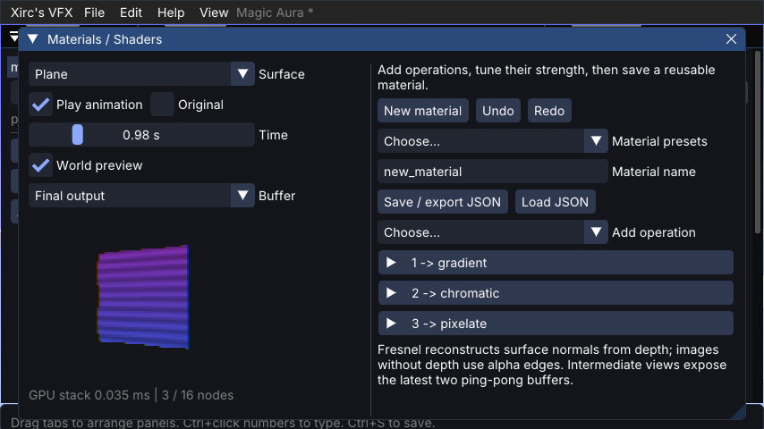

# Xirc's VFX

A reusable Minecraft **1.21.1 Fabric / NeoForge** visual-effects library by **XircTwerk**. Java 21, MIT licensed original code. Author and maintainer: **XircTwerk**.

The library owns the JSON engine, deterministic simulation, transform hierarchy, curves/gradients, spline and motion fields, sprites, beams, trails, procedural meshes/lightning, pixelization, bloom, code-driven visuals, bounded Photon conversion, project/package utilities, presets and optional ImGui authoring editor. Xirc's VFX Studio is a separate consumer that adds its editor shortcut and application identity.

## Install

Use the matching `xirc_vfx-fabric-0.3.0.jar` or `xirc_vfx-neoforge-0.3.0.jar` from [Releases](https://github.com/XircTwerk/xirc_vfx/releases). Fabric also needs Fabric API. The library registers rendering/ticking once. It does not take the V key; a host mod can open the optional editor explicitly. `/xvfx` supplies local authoring/playback commands.

## Gradle dependency

Standard Maven artifacts include POM dependencies, source jars and Gradle module metadata (public, no token):

```groovy
repositories {
    maven { url = 'https://raw.githubusercontent.com/XircTwerk/xirc_vfx/maven' }
    mavenCentral()
    maven { url = 'https://maven.fabricmc.net/' } // Fabric consumers
}
// Fabric Loom:
dependencies { modImplementation 'com.xirctwerk.vfx:xirc_vfx-fabric:0.3.0' }
// NeoForge: implementation 'com.xirctwerk.vfx:xirc_vfx-neoforge:0.3.0'
// Pure Java: implementation 'com.xirctwerk.vfx:xirc_vfx-core:0.3.0'
```

Declare `xirc_vfx >=0.3.0` as a loader dependency. Loader jars contain the engine, optional editor and nested UI runtime; pure core automatically resolves Gson. Do not install the core jar beside a loader jar. See [API and compatibility policy](docs/LIBRARY_API.md) for full host setup and 0.x version guarantees.

## Client API

Call on the Minecraft client thread after the library initializes:

```java
var project = new com.xirctwerk.vfx.core.Project(
    com.xirctwerk.vfx.core.Templates.create("prismatic_orrery"));
com.xirctwerk.vfx.client.VfxClient.INSTANCE.play(project,
    new com.xirctwerk.vfx.core.Effect.Vec(0, 65, 0));
// Optional authoring UI:
com.xirctwerk.vfx.client.VfxClient.INSTANCE.open();
```

Handles control position, rotation, scale, tint, pause, fade and stop. JSON handles also expose authored named numeric parameters. `Attachments` follows entities with explicit target-loss cleanup. `VfxServer` optionally broadcasts registered JSON effects to supported clients; received definitions and resources are checked before playback.

The four **integration demos are part of this library**, available through Help > Built-in integration examples or `/xvfx demo`. No separate example mod is required. Tools > Diagnostics and `/xvfx profile` show per-effect CPU cost, draw submissions and configurable budgets. [Integration guide](docs/LIBRARY_API.md).

Trusted Java callbacks and endpoint trails use `com.xirctwerk.vfx.api.Vfx` and `RibbonTrail`; see [Code API](docs/CODE_API.md). JSON remains canonical; [format](docs/JSON_FORMAT.md), [schema](schema/effect.schema.json), [capabilities](docs/CAPABILITIES.md), [Photon conversion](docs/PHOTON_IMPORT.md). Code visuals and trails remain client-side; registered JSON effects support optional server-triggered playback.

Existing `xirc_vfx_studio:` effect/texture identifiers remain valid for compatibility. New effects may use your own namespace. A host can call `useProjectDirectory(Path)` before opening the editor to retain its existing projects; default library storage is `config/xirc_vfx`. `setEditorTitle(String)` supplies an application's display name.

## Build

```powershell
.\gradlew.bat :core:test build stageRelease stageMaven
```

On Linux use `bash gradlew`. Both loader jars and source jars are built from the shared implementation. Core semantic/schema/security tests run without Minecraft. The opt-in `-PxircSmokeTest -PxircPackagedSmokeTest` runtime harness exercises the optional editor, world renderer, transforms, bloom, imports and cloud composition on an actual client.

## Licensing

Original project code and original generated sprites/presets: copyright 2026 **XircTwerk**, MIT. Bundled third-party components retain their own licenses and copyright notices; see [THIRD_PARTY_NOTICES.md](THIRD_PARTY_NOTICES.md). This attribution does not designate third-party authors as authors or maintainers of Xirc's VFX.

Developed with assistance from AI coding tools.

Rendering and shader authoring: [RENDERING_API.md](docs/RENDERING_API.md).


